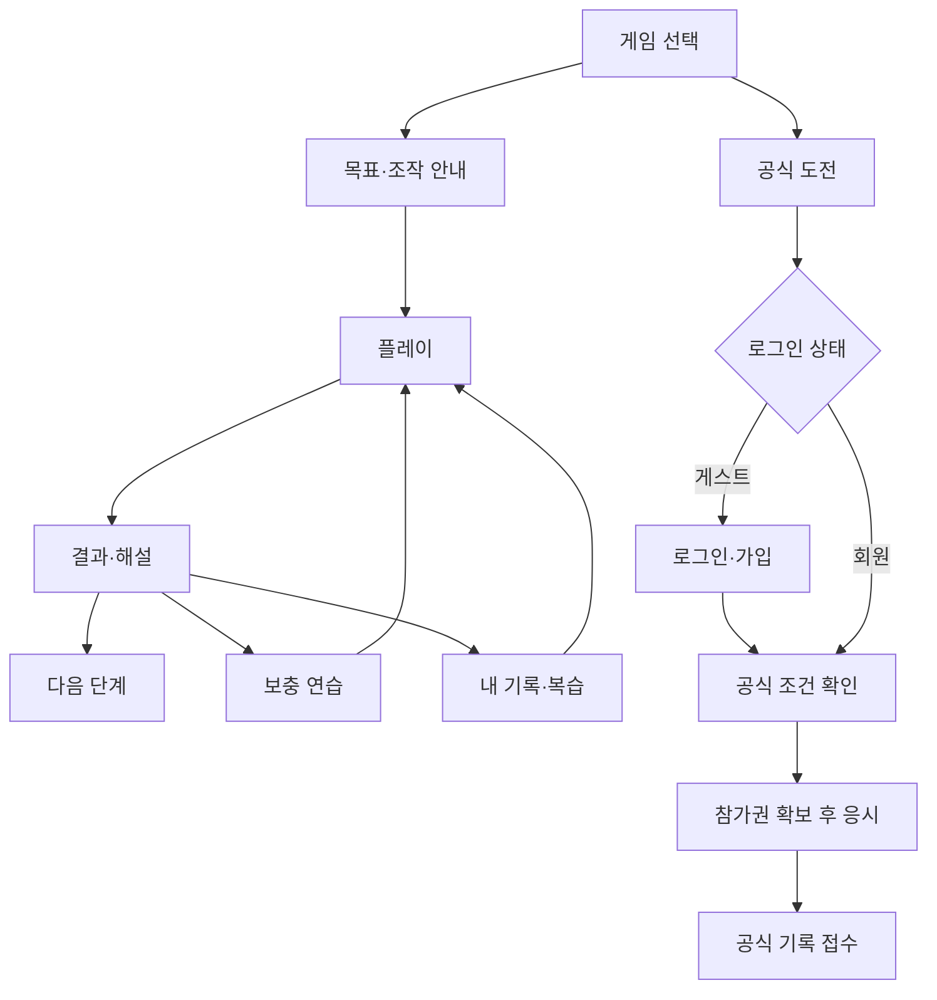

# 화면·이용 흐름 명세

상태: v0.3 · A 디자인 적용 기준 (2026-11-09 사용자 선택). 상품 화면 없음. 사용자에게는 ‘저장됨/기기에 저장됨/동기화 중’처럼 필요한 상태만 보여준다.

## 1. 공통 화면 규칙

- 모바일: 하단 홈·게임·챌린지·내 기록 4개 탐색. PC: 같은 항목을 상단에 배치. 프로필·설정은 별도 버튼.
- 본문 내용 최대 폭 1120px, 기본 글자 18px·보조 설명 16px. 일반 버튼 48~60px, 게임 보드 조작 영역 최소 44×44px. 360px 화면부터 검증. 텍스트 200% 확대에서도 주요 조작 접근 가능.
- A ‘오늘의 한 걸음’: 밝은 아이보리 배경(#f7f7f0), 짙은 녹색 본문·주 행동(#355b43), 따뜻한 흰색 패널. 분야별 차분한 강조색+아이콘+이름. 본문 대비 4.5:1 이상, 조작 경계 3:1 이상을 목표로 검증.
- 키보드 포커스, 모달 진입·복귀, 동작 감소 설정, 소리 끄기 지원. 정답 단서를 색·소리에만 담지 않음.
- 플레이에서는 공통 탐색을 접고 나가기·게임명·모드·현재 단계·문항 수를 표시. 결과에서 일반 탐색 복원.
- 대기 중 버튼 중복 제출 방지. 오류 후 작성 중 답·입력값 보존. 비밀번호는 화면 이동 후 보존하지 않음.

## 2. 화면별 계약

| ID·화면 | 주요 요소 | 주 행동 및 이동 | 빈 상태·실패 |
| --- | --- | --- | --- |
| U01 홈 / | 이어 하기, 선택 복습 최대3, 8게임 입구 | 진행 없으면 ‘첫 게임 체험’→pattern 안내; 진행 있으면 최근 게임 상세 | 추천 없음이면 전체 게임. 서버 장애에도 게스트 로컬 목록 접근 |
| U02 게임 /games | 분야 필터, 카드의 목표·진행 0/30 | 카드→U03 | 필터 결과 없음이면 전체 보기 |
| U03 상세 /games/{id} | 설명, 스테이지 30개, 연습, 공식 도전 | 열린 단계→U04; 잠긴 단계는 필요 선행 단계 안내 | 콘텐츠 불가 시 이유·다른 단계·재시도 |
| U04 안내 | 학습 목표, 조작 예제, 조건·통과 기준 | 체험→시작→U05; 기존 이용자는 체험 생략 | 안내 실패 시 본게임 시작 금지 |
| U05 플레이 | 자극·답안·도움·확정, 문항 진행 | 확정→학습 피드백 또는 다음 공식 문항 | 저장 실패는 답 유지·재전송, 판정 전 다음 문항 금지 |
| U06 결과 | 점수·완료·도움·저장 상태, 해설 | 다음 단계 / 재도전 / 보충 / 게임 상세 | 기록 저장 중에도 결과는 표시, 미저장 상태와 재시도 제공 |
| U07 챌린지 /challenges | 게임별 기간·조건·내 상태·순위 | 게스트는 로그인 후 같은 대회로 복귀; 회원은 U08 | 순위 없음=아직 참가 없음. 취소 대회는 취소 사유 |
| U08 공식 안내 | 문항수·시간·응시1회·중단 정책·입력 방식 | 예제 연습 / ‘공식 응시 시작’ | 참가권 예약 실패면 자극 노출 안 함, 재시도 가능 |
| U09 기록 /records | 게임·난도·도움 필터, 성과 변화·업적 | 기록 상세 / 해당 목표 복습 | ‘첫 기록을 만들어 보세요’→게임. 조건 불일치 자료 합산 금지 |
| U10 계정 /account | ID 표시, 닉네임, 이메일 상태, 로그아웃·탈퇴 | 인증·변경·복구 설정 | 이메일 미연결 안내는 닫기 가능 |
| U11 가입·로그인 | ID, 비밀번호 표시 토글, 이용약관·개인정보 안내 | 성공 후 원래 목적지, 새 가입은 게스트 기록 연결 | 필드별 오류. 비밀번호 오류·없는 계정은 같은 로그인 실패 문구 |
| U12 복구 | ID+복구 이메일 입력, 요청 후 안내 | 메일 링크→새 비밀번호→로그인 | 존재·일치 여부에 무관한 같은 안내. 만료 링크는 재요청 |
| U13 이메일 연결 | 이메일 입력→인증 요청→대기 | 메일 링크 인증 후 연결 완료 | 미인증은 복구 불가. 발송 실패 시 제한 내 재요청 |
| U14 병합 | 계정·게스트 진행 요약, 합치기·나중에 | 동의 후 병합→원래 목적지 | 원본 보존, 중복 합산 없이 재시도 |
| U15 설정 | 글자·소리·동작 감소·연습 표시 속도 | 저장 즉시 일반 화면에 적용 | 공식 시작 후 경기 조건 변경 불가, 종료 후 변경 |
| U16 ID 찾기 | 연결한 복구 이메일 입력 | U11·U12에서 진입, 요청 후 메일 확인 안내 | 연결 여부와 무관한 같은 안내, 화면에 ID 노출하지 않음 |

## 3. 주요 화면의 정보 배치

### 홈 · A ‘오늘의 한 걸음’

상단: 오늘·게임·챌린지·내 기록, 계정·글자 설정. 인사와 실제 완료 단계 수를 표시한다.

첫 영역: 제목 48px(모바일 32~35px), 주 설명 19px(모바일 18px), 단일 시작·이어하기 버튼 60px. 최근 게임의 진행 중 단계·모드를 우선하고, 완료했으면 해당 게임의 다음 열린 단계로 이동한다. 기록 확인 실패 시 잘못된 단계로 진입시키지 않고 저장 오류를 안내한다.

오른쪽에는 기억 보드 모양의 SVG 오브젝트 1개를 둔다. 모바일은 제목 옆 작은 이미지로 줄이고 큰 글자 모드에서는 숨긴다. 실제 문제의 정답을 담지 않는 장식이다.

다음 영역: 방법 익히기 → 게임 도전 → 해설로 돌아보기. 최근 게임 외 다른 플레이 가능한 2종 카드와 ‘게임 모두 보기’로 전체 8종·준비 상태를 확인한다. 대형 통계 패널과 첫 화면의 8종 카드 나열을 제거한다.

### 게임 상세

상단: 뒤로 / 게임명 / 해당 분야

첫 영역: 한 문장 학습 목표, ‘이어 하기’ 주 버튼. A 디자인에서는 넓은 여백과 큰 제목을 사용하고 장식보다 실제 다음 행동을 강조한다.

둘째 영역: 입문·응용·심화 탭, 단계별 열림·완료·독립 해결 표시

하단: 자유 연습, 이번 챌린지, 기록 보기. 게스트도 일반 기능에 같은 위치로 접근.

### 플레이

상단: 나가기 / 게임명·모드 / 문항 n/N

중앙: 현재 지시 → 자극 또는 보드 → 답안

하단: 조작 설명 / 확정. 일반 모드만 규칙·힌트 버튼. 제시 중 확정 비활성.

경로·배열 게임은 드래그와 선택 후 배치·키보드 조작을 제공. 좁은 화면에서 보드 자체의 스크롤이 정답 조건에 영향을 주지 않도록 배치한다.

### 결과

상단: ‘완료했어요’ 또는 ‘다시 도전해 보세요’, 점수·정답 수

중앙: 이번 조건, 도움 여부, 맞힌 부분·확인할 조건, 펼쳐 보는 해설

하단: 통과→다음 단계, 미통과→재도전. 보충 연습과 게임 목록은 보조 행동.

저장 상태: 게스트 ‘이 기기에 저장됨’; 회원 ‘계정에 저장됨’; 대기 ‘저장 중’; 실패 ‘아직 저장되지 않았어요. 다시 시도’. 로컬로만 저장된 상태를 계정 저장 성공으로 표시하지 않는다.

## 4. 상태 흐름

## 5. 나가기·장애·키보드

- 일반 학습의 나가기: ‘현재 문항은 새 문제로 다시 시작할 수 있어요’ 안내. 완료 문항·퍼즐 초안 저장 후 상세로 이동.
- 공식 나가기: ‘공식 응시 기회는 사용되며 다시 시작할 수 없어요’ 확인. 종료된 문항 기록 보존, 미응답은 0점.
- 브라우저 뒤로·새로고침·탭 숨김은 정책의 중단 처리 적용. 브라우저 종료 확인창이 항상 표시된다고 가정하지 않는다.
- 연결 복구 시 전송 상태를 조회한 뒤 재시도한다. 이미 접수된 답을 새 답으로 바꾸지 않는다.
- 키보드는 Tab 탐색, Enter/Space 선택, 방향키 격자 이동, Escape 모달 닫기. 텍스트 입력 중 게임 단축키를 실행하지 않는다.
- 공식 search/switch는 시작 전에 터치·마우스·키보드 중 하나 선택하고 해당 입력 연습을 제공한다. 중간 입력 방식 변경은 공식 순위 대상에서 제외됨을 안내한다.

## 6. 지원 범위와 검증

초기 지원: 출시 당시 최신·직전 주요 버전의 Chrome/Edge/Firefox 데스크톱, Safari macOS/iOS, Chrome Android. 360·390·768·1280px 화면과 큰 글자로 검증한다. 태블릿은 반응형 웹 범위에 포함한다.

보조 기술로 표준 시각 자극을 동일하게 제공할 수 없는 종목에는 가능한 대체 연습을 제공하고 다른 조건임을 표시한다. 동일 공식 순위에 자동 통합하지 않는다. 접근성 지원 수준을 실제 검증 범위에 맞춰 공개한다.

## A 디자인 구현 세부 기준

- 카드 나열을 전부 같은 격자로 만들지 않는다. 홈은 단일 주 행동+작은 선택 목록, 게임 목록은 분야 필터+가로형 카드, 상세는 설명+단계 목록, 기록은 결과별 행, 계정은 한 열 폼이다.
- 단계는 PC 3열, 작은 모바일은 1열로 제목과 조작을 넉넉하게 보여준다. 플레이에서는 PC 문제+전략 2열, 모바일 문제→전략 1열이다.
- 플레이 중 PC·모바일 공통 탐색과 푸터를 숨겨 문제 조작을 가리지 않는다. ‘실험실 나가기’와 현재 게임·단계·저장 상태는 계속 제공한다.
- 정답 위치는 짙은 녹색, 선택은 옅은 녹색+테두리·체크, 오선택은 따뜻한 빨강+×로 구분한다. 밝은 배경에서도 상태가 구별되며 색만으로 판정을 전달하지 않는다.
- 글자 확대 설정은 가능한 경우 이 브라우저에 저장한다. Escape로 설정을 닫으면 열었던 버튼으로 포커스를 돌려준다. 브라우저 확대 시에도 문구·버튼을 고정 높이로 자르지 않는다.
- 회원·저장 API, 게스트 기록·게임 규칙·타이밍은 디자인 변경과 별개로 기존 동작을 보존한다. 준비 중인 게임·경쟁을 사용 가능한 기능으로 표시하지 않는다.

### 코드 브레이커 구현 · 2026-11-12

코드 하나를 최대 추측 횟수 안에 푸는 흐름이다. 안내·구간 예제 후, 코드 칸과 기호 팔레트 아래에 지금까지의 모든 추측과 위치/기호 일치 수를 표시한다. 도움은 전략과 단서 기반 후보로 나누며 풀이 열람은 안내 후 도전을 종료한다. 새로고침은 같은 퍼즐로 복구한다. 결과·기록은 5문항 정답 수 대신 추측 수·해독 여부·점수를 표시한다. 자세한 계약은 [코드 브레이커 구현 문서](../games/code.md)를 따른다.

### 조건 배열 구현 · 2026-11-12

대상 선택 → 번호가 붙은 자리 선택으로 배치하고, 드래그와 자리 교환도 제공한다. 모든 자리를 채운 뒤 확정하며 정오는 편집 중 노출하지 않는다. 틀린 제출은 조건별 설명 화면에서 수정으로 돌아가고, 수정 후 해결은 10000점·도움 사용으로 기록한다. 결과에는 정답 배치·한 가지 풀이·마지막 제출의 조건 설명을 표시한다. 자세한 계약은 [조건 배열 구현 문서](../games/arrangement.md)를 따른다.

### 경로 설계 구현 · 2026-11-12

격자에서 상하좌우 칸 선택·방향키·방향 버튼으로 경로를 잇는다. 방문한 칸 선택은 해당 지점까지의 되돌리기다. 확정 후 지점 누락·방문 순서·상한 설명을 확인하고 수정으로 돌아간다. 결과는 제출과 최단 예시 경로를 전환하며 다른 유효 경로도 인정함을 설명한다. 자세한 계약은 [경로 설계 구현 문서](../games/route.md)를 따른다.

### 신호 탐색 구현 · 2026-11-12

목표 그림·문장을 보며 칸을 선택·취소하고 확정 후 정오·놓침·오선택과 점수를 확인한다. 3개 보드의 평균 결과를 보드별 회고로 다시 살펴볼 수 있다. 중단된 미확정 보드는 다른 탐색판으로 교체하고 완료한 보드는 유지한다. 자세한 계약은 [신호 탐색 구현 문서](../games/search.md)를 따른다.

### 룰 스위치 구현 · 2026-11-13

안내 → 구간 예제 → 현재 지시 1초 → 준비 화면(무제한) → 문항 시작 → 자극·응답 → 확정 피드백 → 다음 문항 → 빈 간격 0.5초 → 규칙 변경 시 지시 1초 → 준비로 이어진다. 20문항 뒤 결과에서 규칙별·전환 직후·시간 초과와 문항별 해설을 살펴본다. 스테이지의 4/5초 제한과 시간 제한 없는 자유 연습을 구분한다. 자극을 본 미확정 문항의 중단은 다른 자극으로 재개하고 준비 중 멈춤과 구분한다. 상세 계약은 [룰 스위치 구현 문서](../games/switch.md)를 따른다.
